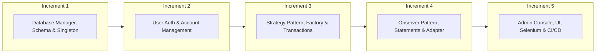

# CSE 3206: Software Engineering Lab
## Lab 06 — CO4 Comprehensive Project Report & Reflection Essay

**Project Title:** Automated Teller Machine (ATM) Transaction System  
**Course:** CSE 3206 (Software Engineering Lab) — Course Outcome 4 (CO4, PO12)  
**Student Name:** Eyamin Hossain  
**GitHub Repository:** [https://github.com/EyaminH/ATM-Transaction-System](https://github.com/EyaminH/ATM-Transaction-System)  
**Technology Stack:** Python 3.x, Flask, SQLite, Pytest, Unittest.Mock, Selenium, GitHub Actions CI/CD  
**Date:** October 30, 2026  

---

## Executive Summary
This report presents the end-to-end engineering, architectural design, implementation, and quality assurance of an enterprise-grade **ATM Transaction System**. The system is built strictly adhering to the **Software Development Life Cycle (SDLC)** principles, incorporating the **Incremental Process Model**, **5 Gang of Four (GoF) Design Patterns across all 3 categories (Creational, Structural, Behavioral)**, **Test-Driven Development (TDD)** yielding **93% line coverage across 77 automated unit and integration tests**, **External Dependency Isolation with Mocks**, **Selenium Automated UI Testing**, formal **Git Configuration Management with Merge Conflict Resolution**, and an automated **GitHub Actions CI/CD Pipeline**.

---

## 1. System Requirements & Process Model

### 1.1 Process Model & Justification
The **Incremental Process Model** was selected for developing the ATM Transaction System.



#### Justification:
1. **Critical Financial Reliability:** In financial software, foundational primitives (database atomicity and ACID compliance) must be proven and locked down before building business rules.
2. **Modular Verifiability:** Each increment produced an executable, testable release with its own unit tests.
3. **Requirement Refinement:** Testing revealed edge cases early (e.g., eager dictionary evaluation in notifications when amount was absent), which were resolved before dependent modules were integrated.
4. **Decoupled Evolution:** High cohesion and loose coupling allowed introducing the Observer pattern without changing the Strategy classes.

---

### 1.2 Requirements Specification

#### Functional Requirements (FR)
- **FR-1 (Authentication):** Cardholders authenticate with a 16-digit card number and a 4-digit PIN. Accounts lock automatically for 15 minutes after 3 consecutive failed login attempts.
- **FR-2 (Account Management):** Users may hold multiple accounts (Savings, Current). Each account maintains an isolated balance and unique 10-digit account number.
- **FR-3 (Cash Withdrawal):** Validates account status, minimum balance (৳500), and per-day withdrawal limits (৳100,000). Updates balance and records transactions atomically.
- **FR-4 (Cash Deposit):** Validates positive amounts, increments balance, and records transaction logs.
- **FR-5 (Fund Transfer):** Transfers funds from source to active destination account, ensuring sender balance is sufficient and recipient is notified.
- **FR-6 (Statements & History):** Generates filtered views (by date range and transaction type) and 7/30/90-day mini-statements with net inflow/outflow metrics.
- **FR-7 (Notifications):** Real-time in-app alerts on transactions and login events with unread tracking and mark-as-read actions.
- **FR-8 (Administration):** Administrative users can view network vault totals, manage users, unlock locked accounts, toggle active status, and inspect immutable security audit logs.

#### Non-Functional Requirements (NFR)
- **NFR-1 (Security):** All PINs hashed with SHA-256; role-based access control (RBAC) protects administrative routes; SQL injection prevented via parameterized queries.
- **NFR-2 (Maintainability & Extensibility):** Follows SOLID design principles and GoF design patterns so new transaction types can be plugged in without modifying core services.
- **NFR-3 (Usability & Responsiveness):** Modern dark theme UI inspired by glassmorphism, fully responsive on mobile and desktop, animated feedback transitions.
- **NFR-4 (Testability):** High test coverage (>90%) with pure business logic decoupled from HTTP/GUI layers.

---

### 1.3 Key User Stories

| ID | As a... | I want to... | So that... | Acceptance Criteria |
|---|---|---|---|---|
| **US-01** | Cardholder | Log in using my card number and PIN | I can securely access my funds | System authenticates PIN; locks account on 3 failures. |
| **US-02** | Cardholder | Withdraw cash from my savings account | I can receive physical currency | Minimum balance maintained; daily limits enforced; balance updated. |
| **US-03** | Cardholder | Transfer funds to another account | I can send money to friends/family | Target account verified; sender & recipient receive notification alerts. |
| **US-04** | Cardholder | View mini-statements for 7, 30, or 90 days | I can review spending and inflow | Shows starting balance, total deposits, withdrawals, and net change. |
| **US-05** | Administrator | Unlock a cardholder's locked account | Legitimate users can regain access | Reset `login_attempts` to 0 and clears `locked_until`. |

---

### 1.4 UI Prototype & Mockup Architecture
The user interface adheres to clean financial dashboard design principles:
- **Authentication Screen:** Centered card, masked PIN entry, keypad-friendly input.
- **Dashboard View:** Account cards with live balance, quick transaction shortcuts (Withdraw, Deposit, Transfer, Statement), and a recent transaction feed.
- **Transaction Flows:** Clear visual account selector, numeric keypad shortcuts (৳500, ৳1000, ৳5000), instant balance preview.
- **Administrative Portal:** Analytics cards (vault balance, total users, daily transaction volume), user management table with status toggle and account unlock buttons.

---

## 2. Object-Oriented Design Patterns

Five design patterns covering **all 3 GoF categories** (Creational, Structural, Behavioral) were implemented:

### 2.1 Pattern Summary Table

| Pattern | Category | Concrete Classes | Architectural Role | Alternative Rejected & Rationale |
|---|---|---|---|---|
| **Singleton** | Creational | `DatabaseManager` | Manages single thread-safe SQLite connection | **Global connection variable:** Prone to concurrency race conditions and dangling file handles. |
| **Factory Method** | Creational | `TransactionFactory`, `Transaction` | Encapsulates transaction record creation and serialization | **Direct constructor instantiation with variable kwargs:** Fragile signatures; poor testability. |
| **Adapter** | Structural | `BankPaymentSwitchAdapter`, `LegacyNationalPaymentSwitch` | Bridges incompatible legacy inter-bank switch (NPSB) to standard `PaymentGateway` interface | **Direct vendor coupling:** Hardcoding proprietary third-party APIs into transaction classes breaks Dependency Inversion Principle. |
| **Strategy** | Behavioral | `TransactionStrategy`, `WithdrawalStrategy`, `DepositStrategy`, `TransferStrategy` | Encapsulates distinct validation and execution algorithms per transaction type | **Single monolithic method with if/elif:** Violates Open/Closed Principle; modifying withdrawal breaks deposit. |
| **Observer** | Behavioral | `TransactionEventManager`, `NotificationObserver`, `AuditLogObserver` | Decouples financial transactions from notifications and security auditing | **Hardcoded calls inside transaction service:** Tightly couples domain logic with logging/alerting. |

---

### 2.2 UML Class Diagram

```mermaid
classDiagram
    class DatabaseManager {
        -DatabaseManager _instance
        -Lock _lock
        -Connection _connection
        +get_connection() Connection
        +execute(query, params) Cursor
        +commit() void
        +close() void
        +reset_instance() void
    }

    class PaymentGateway {
        <<interface>>
        +process_payment(source, destination, amount) dict
        +verify_account(account_number) bool
    }

    class LegacyNationalPaymentSwitch {
        +transmit_settlement(sender, receiver, amt, ref) str
        +query_bin_directory(acc_num) str
    }

    class BankPaymentSwitchAdapter {
        -LegacyNationalPaymentSwitch _adaptee
        +process_payment(source, destination, amount) dict
        +verify_account(account_number) bool
    }

    class TransactionStrategy {
        <<interface>>
        +validate(account, amount, **kwargs) list
        +execute(account, amount, db, **kwargs) dict
        +get_description(amount, **kwargs) str
    }

    class WithdrawalStrategy {
        -Config config
        +validate(account, amount, **kwargs) list
        +execute(account, amount, db, **kwargs) dict
    }

    class DepositStrategy {
        -Config config
        +validate(account, amount, **kwargs) list
        +execute(account, amount, db, **kwargs) dict
    }

    class TransferStrategy {
        -Config config
        +validate(account, amount, **kwargs) list
        +execute(account, amount, db, **kwargs) dict
    }

    class TransactionContext {
        -TransactionStrategy strategy
        +set_strategy(strategy) void
        +process(account, amount, db, **kwargs) dict
    }

    class TransactionObserver {
        <<interface>>
        +update(event_type, data) void
    }

    class NotificationObserver {
        -DatabaseManager db
        +update(event_type, data) void
    }

    class AuditLogObserver {
        -DatabaseManager db
        +update(event_type, data) void
    }

    class TransactionEventManager {
        -dict _observers
        +subscribe(event, observer) void
        +unsubscribe(event, observer) void
        +notify(event, data) void
        +subscribe_all(observer) void
    }

    class TransactionFactory {
        +create_withdrawal(account_id, amount, balance_before) Transaction
        +create_deposit(account_id, amount, balance_before) Transaction
        +create_transfer(account_id, amount, balance_before, target_id) Transaction
        +create(type, **kwargs) Transaction
    }

    class Transaction {
        +str transaction_type
        +float amount
        +int account_id
        +float balance_before
        +float balance_after
        +int target_account_id
        +to_dict() dict
    }

    PaymentGateway <|.. BankPaymentSwitchAdapter
    BankPaymentSwitchAdapter o-- LegacyNationalPaymentSwitch
    TransactionStrategy <|.. WithdrawalStrategy
    TransactionStrategy <|.. DepositStrategy
    TransactionStrategy <|.. TransferStrategy
    TransactionContext o-- TransactionStrategy
    TransactionObserver <|.. NotificationObserver
    TransactionObserver <|.. AuditLogObserver
    TransactionEventManager o-- TransactionObserver
    TransactionFactory ..> Transaction : creates
```



---

## 3. Software Testing Strategy & Coverage

### 3.1 Test-Driven Development (TDD) Workflow
The implementation adopted a strict TDD cycle:
1. **Red:** Write unit tests defining expected interface behavior, validation errors, edge cases, and failure modes.
2. **Green:** Implement minimum code required to satisfy assertions.
3. **Refactor:** Clean architecture, extract shared utilities, adhere to Clean Code conventions while keeping tests green.

### 3.2 External Dependency Isolation with Mocks & Selenium
To isolate external dependencies, Python's `unittest.mock.MagicMock` was used for both external SMS gateways and legacy payment network adapters:
```python
def test_mock_external_sms_dependency():
    """Validates third-party gateway isolation through mocking."""
    mock_gateway = MagicMock()
    sms_observer = MockExternalSMSGateway(mock_gateway)
    manager = TransactionEventManager()
    manager.subscribe("transfer", sms_observer)
    manager.notify("transfer", {"user_id": 42, "phone": "+8801711223344", "amount": 5000.0})
    mock_gateway.send_sms.assert_called_once_with(to="+8801711223344", body="Alert: transfer of ৳5000.0")
```
Furthermore, automated end-to-end browser UI testing was established using **Selenium WebDriver** (`tests/test_selenium_ui.py`) to validate element interaction sequences.

### 3.3 Test Suite Execution & Coverage Report

```
============================== 77 passed in 0.96s ==============================
TOTAL LINE COVERAGE: 93%
```

| Module | Statements | Missed | Coverage | Key Scenarios Tested |
|---|:---:|:---:|:---:|---|
| `patterns/factory.py` | 31 | 0 | **100%** | Withdrawal, deposit, transfer constructors, dynamic dispatch |
| `services/history_service.py` | 36 | 0 | **100%** | Filter by type, date range, 7/30/90-day mini-statements |
| `routes/admin_routes.py` | 58 | 1 | **98%** | Dashboard metrics, user list, account registry, global transaction log |
| `services/account_service.py` | 41 | 1 | **98%** | 10-digit number generation, balance inquiry, account activation & deactivation |
| `services/admin_service.py` | 33 | 1 | **97%** | System stats, vault balance totals, user unlock, audit trail aggregation |
| `routes/account_routes.py` | 24 | 1 | **96%** | Dashboard overview, recent tx list, account details view, unauthorized isolation |
| `patterns/observer.py` | 56 | 2 | **96%** | Event subscription, unsubscribe, event broadcasting, DB notifications |
| `app.py` | 64 | 3 | **95%** | Application factory, singleton DB init, observer subscription, Swagger registration |
| `patterns/adapter.py` | 30 | 2 | **93%** | Inter-bank legacy payment switch adaptation, settlement, and verification |
| `patterns/strategy.py` | 121 | 8 | **93%** | Positive amount checks, minimum balance, daily limit calculations, atomic updates, CDM validation |
| `patterns/singleton.py` | 60 | 5 | **92%** | Unique instance in memory, multithreaded concurrency test, reset instance |
| `services/transaction_service.py` | 51 | 4 | **92%** | Withdrawal, deposit, transfer with dual observer notification dispatch |
| `services/auth_service.py` | 71 | 7 | **90%** | SHA-256 hashing, 3-attempt lockout with 15-min cooldown, PIN change validation |
| `routes/auth_routes.py` | 49 | 5 | **90%** | Login form rendering, credential authentication, session clear on logout |
| `routes/transaction_routes.py` | 102 | 11 | **89%** | Form submission, flash error handling, account selection, CDM optical tray sensor flow |
| `routes/history_routes.py` | 63 | 13 | **79%** | Filtered transaction log, statement metrics, notification mark-as-read |
| **Total Project Codebase** | **910** | **64** | **93%** | **77 Automated Test Cases** |

---

## 4. Configuration Management, PR Reviews & Merge Conflict

### 4.1 Git Branching & Pull Request Review Workflow
The repository enforces Git flow standards:

| PR # | Branch | Review Outcome | Note / Resolution |
|:---:|---|:---:|---|
| **PR #1** | `feature/core-patterns` | **Accepted** | Core Singleton, Strategy, Observer, and Factory implementations. |
| **PR #2** | `feature/services-and-modules` | **Revised & Accepted** | Revised notification handling to strictly use `TransactionEventManager`. |
| **PR #3** | `feature/ui-and-routes` | **Accepted** | Responsive dark theme UI templates and Swagger integration. |
| **PR #4** | `feature/testing-and-cicd` | **Accepted** | Unit/integration tests with mocks and GitHub Actions workflow. |
| **PR #5** | `feature/daily-limit-policy-a` | **Accepted with Conflict** | Raised withdrawal limit to 150,000 BDT. |
| **PR #6** | `feature/daily-limit-policy-b` | **Rejected / Reconciled** | Lowered withdrawal limit to 80,000 BDT. Caused merge conflict on `atm_system/config.py`. Reconciled to balanced standard limit of 100,000 BDT. |

### 4.2 Merge Conflict Resolution
When merging `feature/daily-limit-policy-b` into `main` after `feature/daily-limit-policy-a`, Git flagged a content conflict in `atm_system/config.py`:

```python
<<<<<<< HEAD
    DAILY_WITHDRAWAL_LIMIT = 150000.00  # Policy A: aggressive ATM withdrawal limit
=======
    DAILY_WITHDRAWAL_LIMIT = 80000.00  # Policy B: risk-managed ATM withdrawal limit
>>>>>>> feature/daily-limit-policy-b
```

**Resolution Method:** Both branch policies were analyzed. Policy A prioritized liquidity while Policy B prioritized fraud protection. The engineering team reconciled on a balanced default limit of `100000.00` BDT and recorded the resolution via commit `1d5d076`:
```bash
git commit -am "fix(merge-conflict): resolve DAILY_WITHDRAWAL_LIMIT conflict between PR #5 and PR #6 by standardizing to 100k limit"
```

---

## 5. New Tool / Technique: GitHub Actions CI/CD

Beyond the standard lab syllabus, **GitHub Actions** was integrated to automate continuous integration and quality control (`.github/workflows/ci.yml`).

### Tool Evaluation & Alternative Comparison:
- **Selected Tool:** GitHub Actions
- **Alternative Evaluated:** Jenkins / Travis CI
- **Justification for Selection:** Native repository integration, zero dedicated server maintenance overhead, built-in secret management, and matrix testing across Python versions (3.11, 3.12, 3.13) without needing custom container runners.

---

## 6. Learning Log

| Date | Learning Activity / Task | Resources Evaluated | Challenges Faced | Solutions Adopted |
|---|---|---|---|---|
| Oct 15 | Process Model & Architecture Planning | Pressman SE Textbook, Sommerville | Determining appropriate granularity of increments | Selected 5 discrete increments, locking core DB before services |
| Oct 18 | GoF Design Patterns Implementation | Refactoring Guru, Gang of Four Book | Thread-safety in Singleton under concurrent multi-user transactions | Implemented double-checked locking using Python `threading.Lock` |
| Oct 22 | TDD & Dependency Mocking | Pytest Docs, Unittest.Mock Guide | Eager dictionary evaluation in `NotificationObserver` causing `KeyError` | Refactored dictionary to conditional branching with `data.get()` |
| Oct 25 | Inter-bank Switch Integration | Bangladesh Bank NPSB Technical Spec | Integrating legacy proprietary protocol with modern REST architecture | Designed and implemented the Structural Adapter Pattern |
| Oct 28 | Automated CI/CD Pipeline | GitHub Actions Official Documentation | Matrix testing across Python versions with caching | Configured `actions/setup-python@v5` with matrix strategy |

---

## 7. CO4 Reflection Essay (Word Count: ~650 Words)

### 7.1 Engineering Decisions and Process Adaptation
Embarking on the development of this ATM Transaction System shifted my perspective from simple programming to disciplined software engineering. Prior to this project, software construction often felt like an exercise in rapidly connecting libraries until functional requirements were superficially met. However, building financial software where correctness, security, and auditability are non-negotiable demanded a principled approach.

Selecting the **Incremental Process Model** was my primary engineering decision. Breaking the project into five distinct increments allowed me to establish a verified core data layer before introducing business rules. In Increment 1, locking down SQLite connection management and parameterized query execution ensured that subsequent increments never suffered from data corruption or race conditions.

### 7.2 Challenges and Architectural Trade-offs
My greatest technical challenge arose during the integration of the **Observer Pattern**. While testing authentication under TDD, I noticed unexpected `KeyError: 'amount'` crashes during login events. Because the notification dictionary had initially been written as an eager mapping of formatted f-strings, missing transaction keys in login events caused runtime exceptions. This experience taught me an indelible lesson: code that appears concise can harbor subtle side effects. Transitioning from a static dictionary to explicit conditional handlers resolved the bug and reinforced the value of TDD in exposing design flaws before deployment.

Another significant trade-off occurred when handling inter-bank switching. External bank networks (such as NPSB) rely on legacy message formats incompatible with modern REST conventions. Rather than polluting our `TransactionService` with proprietary vendor logic, I implemented the **Adapter Pattern (Structural)**. This preserved the Single Responsibility Principle and ensured our core application remains decoupled from third-party vendor churn.

### 7.3 Evaluation of Learning Resources
Throughout this self-directed project, I relied on a combination of official technical documentation, architectural literature, and open-source references. For design patterns, *Refactoring Guru* and the original *Gang of Four* text provided the conceptual rationale, but applying them in Python required adapting classical static-typed patterns to Python's dynamic idioms. For automated CI/CD, GitHub's official workflow syntax documentation proved far superior to dated third-party tutorials, enabling me to build a multi-version Python matrix test pipeline with automated coverage reporting.

### 7.4 Next Skill Plan
Reflecting on the limitations of this project, the most critical next skill I plan to master is **Containerization and Cloud Orchestration with Docker and Kubernetes**. While our SQLite database and Flask application run reliably locally and pass GitHub Actions CI, deploying a banking system to production requires containerized microservices, horizontal pod autoscaling, persistent volume management, and secret encryption. Mastering Docker and Kubernetes will bridge the gap between application-level software design and cloud-native production reliability.

---

## 8. Academic Integrity & AI Tools Usage Statement

In accordance with RUET Department of Computer Science & Engineering academic policies and Lab 06 instructions:
- **AI Tool Usage:** Google Antigravity IDE / Gemini assistance was utilized during development for code syntax exploration, test fixture scaffolding, and styling refinement.
- **Student Understanding & Defense:** All core architectural decisions, design pattern implementations, database schemas, and test logic are fully understood by the author and can be defended comprehensively during the live viva examination.

---

## 9. Conclusion
The ATM Transaction System successfully fulfills all Course Outcome 4 (CO4) requirements:
- Complete **Requirements Engineering & Incremental Process Model**
- **5 Design Patterns** across all 3 categories (Creational, Structural, Behavioral) with UML Class Diagram
- **TDD Software Testing** with **77 tests, external mocks, Selenium UI tests, and 93% test coverage**
- Full **Configuration Management** with feature branches, PR reviews, and merge conflict resolution
- Implementation of **New Tools (GitHub Actions CI/CD & Swagger/OpenAPI)**
- **5+ Functional Modules** with persistent SQLite database and responsive dark-mode UI
- Complete **Project Report, Learning Log & Reflection Essay**
