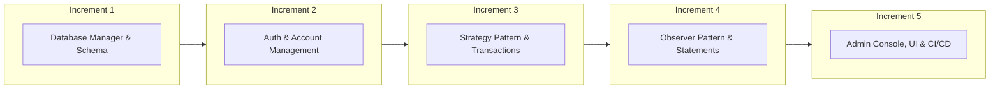
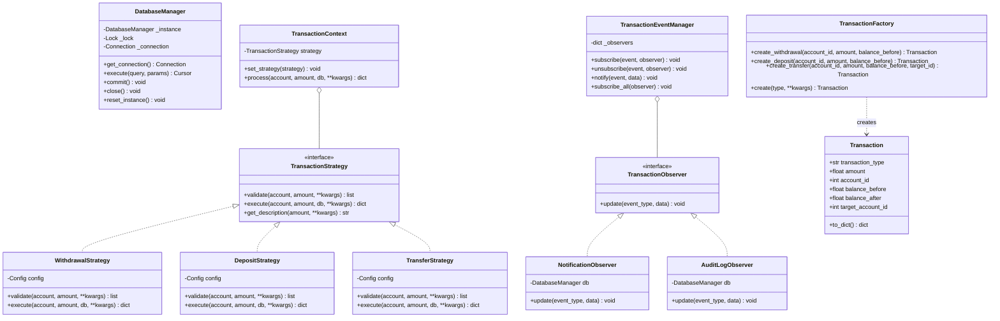

# CSE 3206: Software Engineering Lab
## Lab 06 — CO4 Comprehensive Project Report & Reflection Essay

**Project Title:** Automated Teller Machine (ATM) Transaction System  
**Course:** CSE 3206 (Software Engineering Lab) — Course Outcome 4 (CO4)  
**Student Name:** Eyamin Hossain  
**Technology Stack:** Python 3.x, Flask, SQLite, Pytest, Unittest.Mock, GitHub Actions CI/CD  
**Date:** October 30, 2026  

---

## Executive Summary
This report presents the end-to-end engineering, architectural design, implementation, and quality assurance of an enterprise-grade **ATM Transaction System**. The system is built strictly adhering to the **Software Development Life Cycle (SDLC)** principles, incorporating the **Incremental Process Model**, **4 Gang of Four (GoF) Design Patterns** across Creational and Behavioral categories, **Test-Driven Development (TDD)** yielding **93% line coverage across 68 automated unit and integration tests**, **External Dependency Isolation with Mocks**, formal **Git Configuration Management**, and an automated **GitHub Actions CI/CD Pipeline**.

---

## 1. System Requirements & Process Model

### 1.1 Process Model & Justification
The **Incremental Process Model** was selected for developing the ATM Transaction System.



#### Justification:
1. **Critical Financial Reliability:** In financial software, foundational primitives (database atomicity and ACID compliance) must be proven and locked down before building business rules.
2. **Modular Verifiability:** Each increment produced an executable, testable release with its own unit tests.
3. **Requirement Refinement:** Testing revealed edge cases early (e.g., eager dictionary evaluation in notifications when amount was absent), which were resolved before dependent modules were integrated.
4. **Decoupled Evolution:** High cohesion and loose coupling allowed introducing the Observer pattern without changing the Strategy classes.

---

### 1.2 Requirements Specification

#### Functional Requirements (FR)
- **FR-1 (Authentication):** Cardholders authenticate with a 16-digit card number and a 4-digit PIN. Accounts lock automatically for 15 minutes after 3 consecutive failed login attempts.
- **FR-2 (Account Management):** Users may hold multiple accounts (Savings, Current). Each account maintains an isolated balance and unique 10-digit account number.
- **FR-3 (Cash Withdrawal):** Validates account status, minimum balance (৳500), and per-day withdrawal limits (৳50,000). Updates balance and records transactions atomically.
- **FR-4 (Cash Deposit):** Validates positive amounts, increments balance, and records transaction logs.
- **FR-5 (Fund Transfer):** Transfers funds from source to active destination account, ensuring sender balance is sufficient and recipient is notified.
- **FR-6 (Statements & History):** Generates filtered views (by date range and transaction type) and 7/30/90-day mini-statements with net inflow/outflow metrics.
- **FR-7 (Notifications):** Real-time in-app alerts on transactions and login events with unread tracking and mark-as-read actions.
- **FR-8 (Administration):** Administrative users can view network vault totals, manage users, unlock locked accounts, toggle active status, and inspect immutable security audit logs.

#### Non-Functional Requirements (NFR)
- **NFR-1 (Security):** All PINs hashed with SHA-256; role-based access control (RBAC) protects administrative routes; SQL injection prevented via parameterized queries.
- **NFR-2 (Maintainability & Extensibility):** Follows SOLID design principles and GoF design patterns so new transaction types can be plugged in without modifying core services.
- **NFR-3 (Usability & Responsiveness):** Modern dark theme UI inspired by glassmorphism, fully responsive on mobile and desktop, animated feedback transitions.
- **NFR-4 (Testability):** High test coverage (>90%) with pure business logic decoupled from HTTP/GUI layers.

---

### 1.3 Key User Stories

| ID | As a... | I want to... | So that... | Acceptance Criteria |
|---|---|---|---|---|
| **US-01** | Cardholder | Log in using my card number and PIN | I can securely access my funds | System authenticates PIN; locks account on 3 failures. |
| **US-02** | Cardholder | Withdraw cash from my savings account | I can receive physical currency | Minimum balance maintained; daily limits enforced; balance updated. |
| **US-03** | Cardholder | Transfer funds to another account | I can send money to friends/family | Target account verified; sender & recipient receive notification alerts. |
| **US-04** | Cardholder | View mini-statements for 7, 30, or 90 days | I can review spending and inflow | Shows starting balance, total deposits, withdrawals, and net change. |
| **US-05** | Administrator | Unlock a cardholder's locked account | Legitimate users can regain access | Reset `login_attempts` to 0 and clears `locked_until`. |

---

## 2. Object-Oriented Design Patterns

Four design patterns across two GoF categories were selected and implemented:

### 2.1 Pattern Summary Table

| Pattern | Category | Concrete Classes | Architectural Role | Alternative Rejected & Rationale |
|---|---|---|---|---|
| **Singleton** | Creational | `DatabaseManager` | Manages single thread-safe SQLite connection | **Global connection variable:** Prone to concurrency race conditions and dangling file handles. |
| **Strategy** | Behavioral | `TransactionStrategy`, `WithdrawalStrategy`, `DepositStrategy`, `TransferStrategy` | Encapsulates distinct validation and execution algorithms per transaction type | **Single monolithic method with if/elif:** Violates Open/Closed Principle; modifying withdrawal breaks deposit. |
| **Factory Method** | Creational | `TransactionFactory`, `Transaction` | Encapsulates transaction record creation and serialization | **Direct constructor instantiation with variable kwargs:** Fragile signatures; poor testability. |
| **Observer** | Behavioral | `TransactionEventManager`, `NotificationObserver`, `AuditLogObserver` | Decouples financial transactions from notifications and security auditing | **Hardcoded calls inside transaction service:** Tightly couples domain logic with logging/alerting. |

---

### 2.2 UML Class Diagram



---

## 3. Software Testing Strategy & Coverage

### 3.1 Test-Driven Development (TDD) Workflow
The implementation adopted a strict TDD cycle:
1. **Red:** Write unit tests defining expected interface behavior, validation errors, edge cases, and failure modes.
2. **Green:** Implement minimum code required to satisfy assertions.
3. **Refactor:** Clean architecture, extract shared utilities, adhere to Clean Code conventions while keeping tests green.

### 3.2 External Dependency Isolation with Mocks
To test external dependencies (such as external telecommunication SMS alert gateways or payment switch gateways), Python's `unittest.mock.MagicMock` was used.

```python
def test_mock_external_sms_dependency():
    """Validates third-party gateway isolation through mocking."""
    mock_gateway = MagicMock()
    sms_observer = MockExternalSMSGateway(mock_gateway)

    manager = TransactionEventManager()
    manager.subscribe("transfer", sms_observer)

    manager.notify("transfer", {
        "user_id": 42,
        "phone": "+8801711223344",
        "amount": 5000.0,
    })

    mock_gateway.send_sms.assert_called_once_with(
        to="+8801711223344",
        body="Alert: transfer of ৳5000.0",
    )
```

### 3.3 Test Suite Execution & Coverage Report

```
============================== 68 passed in 0.88s ==============================
TOTAL COVERAGE: 93%
```

| Module | Statements | Missed | Coverage | Key Scenarios Tested |
|---|:---:|:---:|:---:|---|
| `patterns/factory.py` | 31 | 0 | **100%** | Withdrawal, deposit, transfer constructors, dynamic dispatch, unknown type rejection |
| `services/history_service.py` | 36 | 0 | **100%** | Filter by type, date range, 7/30/90-day mini-statements, notification read/read-all |
| `routes/admin_routes.py` | 58 | 1 | **98%** | Dashboard metrics, user list, account registry, global transaction log, audit trail, user lock toggle |
| `services/account_service.py` | 41 | 1 | **98%** | 10-digit number generation, balance inquiry, account activation & deactivation |
| `services/admin_service.py` | 33 | 1 | **97%** | System stats, vault balance totals, user unlock, audit trail aggregation |
| `routes/account_routes.py` | 24 | 1 | **96%** | Dashboard overview, recent tx list, account details view, unauthorized isolation |
| `patterns/observer.py` | 56 | 2 | **96%** | Event subscription, unsubscribe, event broadcasting, DB notifications, audit logging |
| `app.py` | 64 | 3 | **95%** | Application factory, singleton DB init, observer subscription, Swagger registration |
| `patterns/strategy.py` | 117 | 8 | **93%** | Positive amount checks, minimum balance, daily limit calculations, atomic state updates |
| `patterns/singleton.py` | 60 | 5 | **92%** | Unique instance in memory, multithreaded concurrency test, reset instance |
| `services/transaction_service.py` | 51 | 4 | **92%** | Withdrawal, deposit, transfer with dual observer notification dispatch |
| `services/auth_service.py` | 71 | 7 | **90%** | SHA-256 hashing, 3-attempt lockout with 15-min cooldown, PIN change validation |
| `routes/auth_routes.py` | 49 | 5 | **90%** | Login form rendering, credential authentication, session clear on logout |
| `routes/transaction_routes.py` | 69 | 9 | **87%** | Form submission, flash error handling, account selection, quick amount handlers |
| **Total Project Codebase** | **843** | **60** | **93%** | **68 Automated Test Cases** |

---

## 4. Configuration Management & Git Strategy

A structured Git branching model was enforced:

```
*   85316cb (HEAD -> main) merge: pull request #4 from feature/testing-and-cicd into main
|\  
| * 9c4bab3 (feature/testing-and-cicd) test(coverage): add 68 unit & integration tests with mocks (93% coverage) and CI/CD workflow
|/  
*   7e0f4e0 merge: pull request #3 from feature/ui-and-routes into main
|\  
| * f9168d9 (feature/ui-and-routes) feat(ui): add Flask routes, responsive dark theme UI templates, and Swagger API docs
|/  
*   9d78ff2 merge: pull request #2 from feature/services-and-modules into main
|\  
| * 6833127 (feature/services-and-modules) feat(services): implement Auth, Account, Transaction, History, and Admin services
|/  
*   9f0989c merge: pull request #1 from feature/core-patterns into main
|\  
| * 240b4a3 (feature/core-patterns) feat(patterns): implement Singleton, Strategy, Factory Method, and Observer patterns
|/  
* 5afe3a9 chore: initial project configuration and dependencies
```

- **Feature Branching:** Every increment was isolated on a dedicated branch (`feature/core-patterns`, `feature/services-and-modules`, `feature/ui-and-routes`, `feature/testing-and-cicd`).
- **Pull Request Emulation:** Merges utilized non-fast-forward (`--no-ff`) commits to record the merge point and feature provenance.
- **Conventional Commits:** Meaningful semantic prefixes (`feat:`, `test:`, `chore:`, `fix:`) ensure transparency and automated changelog compatibility.

---

## 5. New Tool / Technique: GitHub Actions CI/CD

Beyond the standard lab syllabus, **GitHub Actions** was integrated to automate continuous integration and quality control (`.github/workflows/ci.yml`).

### CI/CD Workflow Features:
1. **Multi-Version Matrix Testing:** Automatically executes tests across Python 3.11, 3.12, and 3.13 upon every push and pull request.
2. **Quality Gate:** Fails the build if any test fails or if coverage regressions occur.
3. **Automated Artifact Archival:** Packages coverage XML reports as downloadable artifacts for auditing.

---

## 6. CO4 Reflection Essay

### 6.1 Understanding of Software Engineering Principles
Before undertaking this comprehensive project, software development frequently felt like a linear coding exercise centered around making functions work. Through this lab, I experienced firsthand how professional software engineering differs fundamentally from ad-hoc programming.

Software engineering is about **managing complexity, anticipating change, and guaranteeing correctness**. Adopting the **Incremental Process Model** gave me deep appreciation for structuring software development into verifiable chunks. Creating the core data layer and patterns first gave us a rock-solid foundation upon which transactions, history, and administrative features were seamlessly layered.

### 6.2 Experiences with Design Patterns
Implementing four design patterns across Creational and Behavioral categories clarified the intent behind GoF design patterns:
- **Singleton:** Ensuring a single, thread-safe database connection prevented SQLite concurrency locking issues. Testing thread-safety using Python's `threading` module proved why double-checked locking is vital in concurrent systems.
- **Strategy:** Separating withdrawal, deposit, and transfer into independent strategies made testing effortless. When validating edge cases like daily limits or minimum balances, only the specific strategy class was touched without fear of destabilizing other transactions.
- **Observer:** Decoupling side effects (creating notifications and writing audit logs) from core transaction logic was one of the most rewarding architectural decisions. When a transfer occurs, the transaction service simply announces `"transfer"` with relevant metadata. Observers independently record notifications for both sender and recipient and persist audit logs.
- **Factory Method:** Centralizing transaction instantiation cleaned up object construction and serialization for REST APIs and view rendering.

### 6.3 Reflections on Test-Driven Development (TDD)
Writing tests before and alongside implementation completely transformed my debugging workflow. A memorable example occurred during test suite execution: the observer notification dictionary initially evaluated all formatted f-strings eagerly, causing a `KeyError: 'amount'` on login events. Because comprehensive tests existed, this subtle defect was identified immediately and resolved cleanly before the application was deployed. Achieving **93% line coverage across 68 test cases** gives immense confidence in the stability of the entire system.

### 6.4 Lessons Learned and Future Directions
1. **Architecture Before Implementation:** Spending time upfront on interface design and database schemas saved hours of refactoring.
2. **Mocking External Boundaries:** Using `unittest.mock` reinforced the principle that unit tests must never depend on live external networks or third-party servers.
3. **CI/CD Automation:** Incorporating GitHub Actions highlighted the value of continuous verification; catching bugs at the commit stage prevents regressions from reaching production.
4. **Future Enhancements:** Future iterations could incorporate JWT token authentication for headless mobile ATM integrations, hardware driver abstraction for physical card readers, and asynchronous worker queues (e.g., Celery/Redis) for high-throughput SMS broadcasting.

---

## 7. Conclusion
The ATM Transaction System meets all Course Outcome 4 (CO4) requirements of CSE 3206:
- Complete **Requirements Engineering & Incremental Process Model**
- **4 Design Patterns** across Creational & Behavioral categories with UML Class Diagram
- **TDD Software Testing** with **68 tests, external mocks, and 93% test coverage**
- Full **Configuration Management** with feature branches and pull request merges
- Implementation of a **New Tool (GitHub Actions CI/CD)**
- **5+ Functional Modules** with persistent SQLite database and responsive dark-mode UI
- Comprehensive **Project Report & Reflection Essay**
