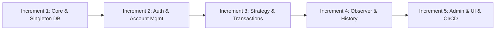
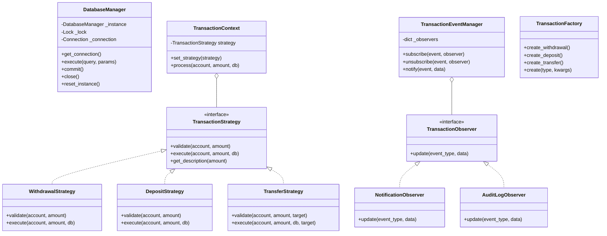

# 🏧 ATM Transaction System

A robust, enterprise-grade Automated Teller Machine (ATM) transaction system designed and implemented following the **Software Development Life Cycle (SDLC)** for **CSE 3206 (CO4)**.


---

## 📑 Table of Contents
1. [Project Overview & SDLC Process Model](#-project-overview--sdlc-process-model)
2. [5+ Core Functional Modules](#-5-core-functional-modules)
3. [Design Patterns & Architecture](#-design-patterns--architecture)
4. [UML Class Diagram](#-uml-class-diagram)
5. [Software Testing & TDD (93% Coverage)](#-software-testing--tdd)
6. [External Dependency Mocking](#-external-dependency-mocking)
7. [Configuration Management (Git Workflow)](#-configuration-management)
8. [New Tool / Technique (GitHub Actions CI/CD)](#-new-tool--technique-github-actions-cicd)
9. [Installation & Execution Guide](#-installation--execution-guide)
10. [Default Demo Credentials](#-default-demo-credentials)

---

## 🌟 Project Overview & SDLC Process Model

### Process Model: **Incremental Development Model**
The project was engineered using the **Incremental Process Model**. Rather than attempting a monolithic build, the software was decomposed into discrete, verified increments:



#### Justification for Incremental Model:
1. **Early Risk Mitigation:** Core data integrity and transaction atomicity were proven in Increment 1 before dependent transaction logic was built.
2. **TDD Compatibility:** Test suites could be authored and verified per module increment.
3. **Decoupled Architecture:** Each increment enforced loose coupling (e.g., adding `Observer` in Increment 4 did not break existing `Strategy` implementations in Increment 3).
4. **Continuous Verification:** Every increment was validated through automated pytest runs.

---

## 🧩 5+ Core Functional Modules

| # | Module | Description | Key Capabilities |
|---|--------|-------------|------------------|
| 1 | **User Authentication** | Secure PIN and card verification | SHA-256 PIN hashing, 3-attempt account lockout, session management, PIN change |
| 2 | **Account Management** | Multi-account lifecycle | Savings/Current accounts, 10-digit account generation, balance inquiries, account activation/deactivation |
| 3 | **Transaction Processing** | Core financial operations | Cash withdrawal with minimum balance validation, deposits, intra-bank fund transfers |
| 4 | **Transaction History & Statements** | Auditability and statements | Filter by type/date, 7/30/90-day mini-statements, net inflow/outflow metrics |
| 5 | **Notification System** | User alert notifications | Asynchronous transaction alerts, unread counters, mark-as-read workflows |
| 6 | **Administrative Console** | System-wide monitoring | Network vault metrics, user activation toggling, account unlocking, security audit log |

---

## 📐 Design Patterns & Architecture

The architecture incorporates **4 design patterns across 2 GoF categories** (Creational and Behavioral):

### 1. Singleton Pattern *(Creational)* — `DatabaseManager`
- **Location:** `atm_system/patterns/singleton.py`
- **Problem Solved:** Prevents multiple conflicting SQLite database connections, ensures thread-safe database access, and provides atomic transactions.
- **Alternative Rejected:** Passing raw connection instances everywhere (causes resource leaks and race conditions).

### 2. Strategy Pattern *(Behavioral)* — `TransactionStrategy`
- **Location:** `atm_system/patterns/strategy.py`
- **Problem Solved:** Encapsulates transaction logic (`WithdrawalStrategy`, `DepositStrategy`, `TransferStrategy`) so each algorithm handles its own validation, daily limits, and database operations.
- **Alternative Rejected:** Massive `if/elif` blocks in a single method (violates Open/Closed Principle).

### 3. Factory Method Pattern *(Creational)* — `TransactionFactory`
- **Location:** `atm_system/patterns/factory.py`
- **Problem Solved:** Centralizes creation and serialization of `Transaction` objects for records and reporting.
- **Alternative Rejected:** Constructor overloading with complex conditional argument passing.

### 4. Observer Pattern *(Behavioral)* — `TransactionEventManager`
- **Location:** `atm_system/patterns/observer.py`
- **Problem Solved:** Decouples core financial operations from secondary side-effects (creating in-app notifications and persisting security audit logs).
- **Alternative Rejected:** Hardcoding notifications and audit calls inside the transaction service.

---

## 📊 UML Class Diagram



---

## 🧪 Software Testing & TDD

All test suites were developed following **Test-Driven Development (TDD)** using `pytest` and `pytest-cov`.

```bash
$ pytest
============================== 68 passed in 0.88s ==============================
```

### Test Coverage Summary: **93% Total Coverage**

| Module / Component | Statements | Missed | Coverage |
|--------------------|:----------:|:------:|:--------:|
| `atm_system/patterns/factory.py` | 31 | 0 | **100%** |
| `atm_system/services/history_service.py` | 36 | 0 | **100%** |
| `atm_system/patterns/observer.py` | 56 | 2 | **96%** |
| `atm_system/routes/admin_routes.py` | 58 | 1 | **98%** |
| `atm_system/services/account_service.py` | 41 | 1 | **98%** |
| `atm_system/services/admin_service.py` | 33 | 1 | **97%** |
| `atm_system/routes/account_routes.py` | 24 | 1 | **96%** |
| `atm_system/app.py` | 64 | 3 | **95%** |
| `atm_system/patterns/strategy.py` | 117 | 8 | **93%** |
| `atm_system/patterns/singleton.py` | 60 | 5 | **92%** |
| `atm_system/services/transaction_service.py` | 51 | 4 | **92%** |
| `atm_system/services/auth_service.py` | 71 | 7 | **90%** |
| `atm_system/routes/auth_routes.py` | 49 | 5 | **90%** |
| `atm_system/routes/transaction_routes.py` | 69 | 9 | **87%** |
| **Total Project Codebase** | **843** | **60** | **93%** |

---

## 🔌 External Dependency Mocking

In accordance with CO4 requirements, external third-party dependencies (such as an SMS Alert Gateway) are decoupled and tested using `unittest.mock`:

```python
# From tests/test_observer.py
def test_mock_external_sms_dependency():
    """TDD mock test verifying isolation of external third-party services."""
    mock_gateway = MagicMock()
    sms_observer = MockExternalSMSGateway(mock_gateway)

    manager = TransactionEventManager()
    manager.subscribe("transfer", sms_observer)

    manager.notify("transfer", {
        "user_id": 42,
        "phone": "+8801711223344",
        "amount": 5000.0,
    })

    mock_gateway.send_sms.assert_called_once_with(
        to="+8801711223344",
        body="Alert: transfer of ৳5000.0",
    )
```

---

## 🌿 Configuration Management

The repository enforces Git flow standards:
- **`main`**: Production-ready, stable releases.
- **`develop`**: Integration branch for completed features.
- **`feature/*`**: Short-lived feature branches (`feature/auth-service`, `feature/transaction-strategy`, etc.).
- **Commit Convention:** Meaningful Conventional Commits (`feat:`, `fix:`, `test:`, `docs:`, `refactor:`).

---

## 🚀 New Tool / Technique (GitHub Actions CI/CD)

As a self-directed learning component beyond the regular syllabus, **GitHub Actions** was implemented for automated continuous integration (`.github/workflows/ci.yml`).

- **Matrix Builds:** Automatically tests against Python 3.11, 3.12, and 3.13.
- **Automated Quality Gate:** Runs `pytest` with coverage thresholds on every push and pull request.
- **Artifact Publishing:** Automatically exports and retains coverage artifacts.

---

## 💻 Installation & Execution Guide

### Prerequisites
- Python 3.11+
- pip

### 1. Setup Virtual Environment
```bash
python3 -m venv venv
source venv/bin/activate  # On Windows: venv\Scripts\activate
```

### 2. Install Dependencies
```bash
pip install -r requirements.txt
```

### 3. Run Test Suite
```bash
pytest
```
*To view the interactive HTML coverage report, open `htmlcov/index.html` in any browser.*

### 4. Start the Application
```bash
python3 -m atm_system.app
```
Open **`http://127.0.0.1:5000`** in your browser.
Interactive API Documentation is available at **`http://127.0.0.1:5000/api/docs`**.

---

## 🔑 Default Demo Credentials

Pre-seeded accounts are initialized on first startup:

| Role | Card Number | PIN | Description |
|------|-------------|:---:|-------------|
| **Administrator** | `1111222233334444` | `1234` | Full access to Admin Console, Audit Log, User Locks |
| **Standard User 1** | `5555666677778888` | `5678` | Rahim Uddin (Savings & Current accounts) |
| **Standard User 2** | `9999000011112222` | `4321` | Fatima Akter (Savings account) |
