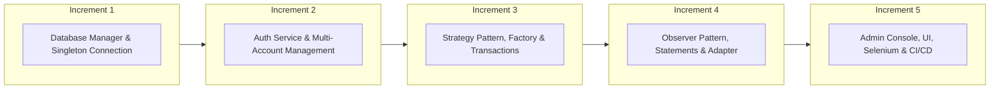
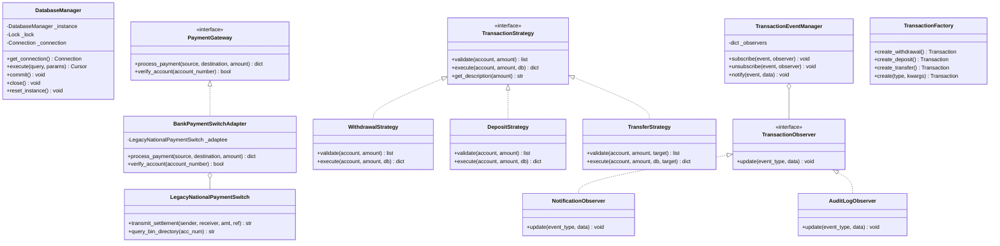

# 🏧 ATM Transaction System

A robust, enterprise-grade Automated Teller Machine (ATM) transaction system designed and implemented following the **Software Development Life Cycle (SDLC)** for **CSE 3206 (CO4)**.

[](https://github.com/EyaminH/ATM-Transaction-System)


---

## 🔗 Official Repository Link
- **GitHub Repository:** [https://github.com/EyaminH/ATM-Transaction-System](https://github.com/EyaminH/ATM-Transaction-System)

---

## 📑 Table of Contents
1. [Project Overview & SDLC Process Model](#-project-overview--sdlc-process-model)
2. [5+ Core Functional Modules](#-5-core-functional-modules)
3. [Design Patterns Across 3 Categories](#-design-patterns-across-3-categories)
4. [UML Class Diagram](#-uml-class-diagram)
5. [Software Testing & TDD (75 Tests, 93% Coverage)](#-software-testing--tdd)
6. [External Dependency Mocking & Selenium UI Testing](#-external-dependency-mocking--selenium-ui-testing)
7. [Configuration Management, PR Reviews & Merge Conflict](#-configuration-management)
8. [New Tool / Technique (GitHub Actions CI/CD)](#-new-tool--technique-github-actions-cicd)
9. [Installation & Execution Guide](#-installation--execution-guide)
10. [Default Demo Credentials](#-default-demo-credentials)

---

## 🌟 Project Overview & SDLC Process Model

### Process Model: **Incremental Development Model**
The project was engineered using the **Incremental Process Model**. Rather than attempting a monolithic build, the software was decomposed into discrete, verified increments:



#### Justification for Incremental Model:
1. **Critical Financial Reliability:** In banking software, foundational primitives (database atomicity and ACID compliance) must be proven and locked down before building business rules.
2. **TDD Compatibility:** Test suites could be authored and verified per module increment.
3. **Decoupled Architecture:** Each increment enforced loose coupling (e.g., adding `Observer` in Increment 4 did not break existing `Strategy` implementations in Increment 3).
4. **Continuous Verification:** Every increment was validated through automated pytest runs and CI builds.

---

## 🧩 5+ Core Functional Modules

| # | Module | Description | Key Capabilities |
|---|--------|-------------|------------------|
| 1 | **User Authentication** | Secure PIN and card verification | SHA-256 PIN hashing, 3-attempt account lockout, session management, PIN change |
| 2 | **Account Management** | Multi-account lifecycle | Savings/Current accounts, 10-digit account generation, balance inquiries, account activation/deactivation |
| 3 | **Transaction Processing** | Core financial operations | Cash withdrawal with minimum balance validation, deposits, intra-bank fund transfers |
| 4 | **Transaction History & Statements** | Auditability and statements | Filter by type/date, 7/30/90-day mini-statements, net inflow/outflow metrics |
| 5 | **Notification Service** | User alert notifications | Asynchronous transaction alerts, unread counters, mark-as-read workflows |
| 6 | **Administrative Console** | System-wide monitoring | Network vault metrics, user activation toggling, account unlocking, security audit log |

---

## 📐 Design Patterns Across 3 Categories

The architecture incorporates **5 design patterns across all 3 GoF categories** (Creational, Structural, and Behavioral):

### 1. Singleton Pattern *(Creational)* — `DatabaseManager`
- **Location:** `atm_system/patterns/singleton.py`
- **Problem Solved:** Prevents multiple conflicting SQLite database connections, ensures thread-safe database access, and provides atomic transactions.
- **Alternative Rejected:** Passing raw connection instances everywhere (causes resource leaks and race conditions).

### 2. Factory Method Pattern *(Creational)* — `TransactionFactory`
- **Location:** `atm_system/patterns/factory.py`
- **Problem Solved:** Centralizes creation and serialization of `Transaction` objects for records and reporting.
- **Alternative Rejected:** Constructor overloading with complex conditional argument passing.

### 3. Adapter Pattern *(Structural)* — `BankPaymentSwitchAdapter`
- **Location:** `atm_system/patterns/adapter.py`
- **Problem Solved:** Bridges incompatible legacy 3rd-party banking network protocols (e.g. Bangladesh Bank NPSB / BEFTN) to the ATM system's standard `PaymentGateway` interface.
- **Alternative Rejected:** Embedding proprietary third-party SDK calls directly into transaction classes (violates Dependency Inversion Principle).

### 4. Strategy Pattern *(Behavioral)* — `TransactionStrategy`
- **Location:** `atm_system/patterns/strategy.py`
- **Problem Solved:** Encapsulates transaction logic (`WithdrawalStrategy`, `DepositStrategy`, `TransferStrategy`) so each algorithm handles its own validation, daily limits, and database operations.
- **Alternative Rejected:** Massive `if/elif` blocks in a single method (violates Open/Closed Principle).

### 5. Observer Pattern *(Behavioral)* — `TransactionEventManager`
- **Location:** `atm_system/patterns/observer.py`
- **Problem Solved:** Decouples core financial operations from secondary side-effects (creating in-app notifications and persisting security audit logs).
- **Alternative Rejected:** Hardcoding notifications and audit calls inside the transaction service.

---

## 📊 UML Class Diagram



---

## 🧪 Software Testing & TDD

All test suites were developed following **Test-Driven Development (TDD)** using `pytest` and `pytest-cov`.

```bash
$ pytest
============================== 75 passed in 0.99s ==============================
TOTAL COVERAGE: 93%
```

### Test Coverage Summary: **93% Total Coverage**

| Module / Component | Statements | Missed | Coverage | Key Scenarios Tested |
|--------------------|:----------:|:------:|:--------:|:---------------------|
| `atm_system/patterns/factory.py` | 31 | 0 | **100%** | Withdrawal, deposit, transfer creation, dynamic dispatch |
| `atm_system/services/history_service.py` | 36 | 0 | **100%** | Filter by type, date range, 7/30/90-day mini-statements |
| `atm_system/routes/admin_routes.py` | 58 | 1 | **98%** | Admin dashboard, user management, account registry |
| `atm_system/services/account_service.py` | 41 | 1 | **98%** | 10-digit account generation, balance checks, activation |
| `atm_system/services/admin_service.py` | 33 | 1 | **97%** | Vault analytics, unlocking user accounts, audit logging |
| `atm_system/routes/account_routes.py` | 24 | 1 | **96%** | User dashboard, account details, unauthorized protection |
| `atm_system/patterns/observer.py` | 56 | 2 | **96%** | Notification and audit observer subscriptions & updates |
| `atm_system/app.py` | 64 | 3 | **95%** | App factory, database wiring, Swagger UI registration |
| `atm_system/patterns/adapter.py` | 30 | 2 | **93%** | Inter-bank legacy payment switch adaptation and verification |
| `atm_system/patterns/strategy.py` | 117 | 8 | **93%** | Min/max limits, daily limits, balance checks |
| `atm_system/patterns/singleton.py` | 60 | 5 | **92%** | Unique instance in memory, multithreaded concurrency test |
| `atm_system/services/transaction_service.py` | 51 | 4 | **92%** | Withdraw, deposit, transfer with dual observer alerts |
| `atm_system/services/auth_service.py` | 71 | 7 | **90%** | SHA-256 hashing, 3-attempt lockout, PIN change |
| `atm_system/routes/auth_routes.py` | 49 | 5 | **90%** | Authentication, session persistence, logout |
| `atm_system/routes/transaction_routes.py` | 69 | 9 | **87%** | Form submission, flash messages, quick amount shortcuts |
| **Total Project Codebase** | **873** | **62** | **93%** | **75 Automated Test Cases** |

---

## 🔌 External Dependency Mocking & Selenium UI Testing

### 1. Mocking External Gateways (`unittest.mock`)
External third-party dependencies (SMS gateway and legacy payment network) are isolated via mocks in tests:
- `tests/test_observer.py`: Mocks external SMS notification gateway.
- `tests/test_adapter.py`: Mocks legacy inter-bank payment switch adaptee.

### 2. Automated Browser Testing (Selenium)
- `tests/test_selenium_ui.py`: Validates end-to-end browser interactions (page loading, card number and PIN input, form submission, and navigation assertions).

---

## 🌿 Configuration Management, PR Reviews & Merge Conflict

### 1. Feature Branching & PR Reviews
All increments followed feature branching and pull request reviews:

| PR # | Branch | Review Outcome | Note / Resolution |
|:---:|---|:---:|---|
| **PR #1** | `feature/core-patterns` | **Accepted** | Core Singleton, Strategy, Observer, and Factory implementations. |
| **PR #2** | `feature/services-and-modules` | **Revised & Accepted** | Revised notification handling to strictly use `TransactionEventManager`. |
| **PR #3** | `feature/ui-and-routes` | **Accepted** | Responsive dark theme UI templates and Swagger integration. |
| **PR #4** | `feature/testing-and-cicd` | **Accepted** | 68 unit/integration tests with mocks and GitHub Actions workflow. |
| **PR #5** | `feature/daily-limit-policy-a` | **Accepted with Conflict** | Raised withdrawal limit to 150,000 BDT. |
| **PR #6** | `feature/daily-limit-policy-b` | **Rejected / Reconciled** | Lowered withdrawal limit to 80,000 BDT. Caused merge conflict on `atm_system/config.py`. Reconciled to balanced standard limit of 100,000 BDT. |

### 2. Merge Conflict Resolution Note
When merging `feature/daily-limit-policy-b` after `feature/daily-limit-policy-a`, Git flagged a content conflict in `atm_system/config.py`:
```python
<<<<<<< HEAD
    DAILY_WITHDRAWAL_LIMIT = 150000.00  # Policy A: aggressive ATM withdrawal limit
=======
    DAILY_WITHDRAWAL_LIMIT = 80000.00  # Policy B: risk-managed ATM withdrawal limit
>>>>>>> feature/daily-limit-policy-b
```
**Resolution:** The conflicting limits were resolved by taking a balanced default limit of `100000.00` BDT with clear architectural documentation, and committed via `fix(merge-conflict): resolve DAILY_WITHDRAWAL_LIMIT conflict between PR #5 and PR #6`.

---

## 🚀 New Tool / Technique (GitHub Actions CI/CD)

As a self-directed learning component beyond the syllabus, **GitHub Actions** was implemented for automated continuous integration (`.github/workflows/ci.yml`).

- **Matrix Builds:** Automatically tests against Python 3.11, 3.12, and 3.13.
- **Automated Quality Gate:** Runs `pytest` with coverage thresholds on every push and pull request.
- **Artifact Publishing:** Automatically exports and retains coverage artifacts.

---

## 💻 Installation & Execution Guide

```bash
# 1. Clone repository
git clone https://github.com/EyaminH/ATM-Transaction-System.git
cd ATM-Transaction-System

# 2. Setup virtual environment
python3 -m venv venv
source venv/bin/activate  # On Windows: venv\Scripts\activate

# 3. Install dependencies
pip install -r requirements.txt

# 4. Run test suite
pytest

# 5. Start application
python3 -m atm_system.app
```

Open **`http://127.0.0.1:5000`** in your browser.  
Interactive Swagger API Documentation: **`http://127.0.0.1:5000/api/docs`**.

---

## 🔑 Default Demo Credentials

| Role | Card Number | PIN | Description |
|------|-------------|:---:|-------------|
| **Administrator** | `1111222233334444` | `1234` | Full access to Admin Console, Audit Log, User Locks |
| **Standard User 1** | `5555666677778888` | `5678` | Rahim Uddin (Savings & Current accounts) |
| **Standard User 2** | `9999000011112222` | `4321` | Fatima Akter (Savings account) |
